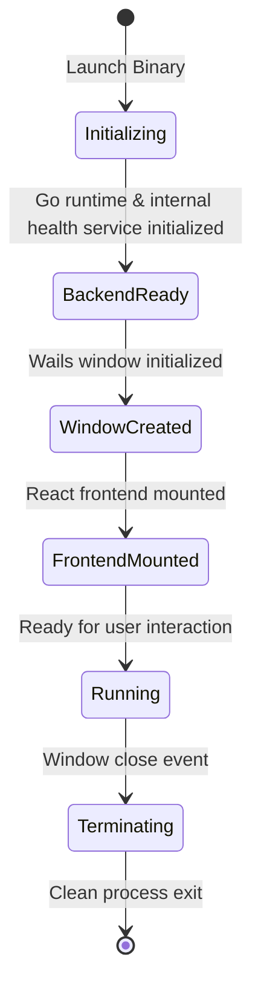

# Data Model: Desktop Application Foundation & Scaffolding

**Feature**: [spec.md](file:///home/alok/building/bodhi-paper-v2/specs/001-init-wails-react/spec.md)  
**Branch**: `001-init-wails-react`  
**Date**: 2026-11-12  

---

## Entities

### 1. HealthResponse
Represents the runtime operational status of the local desktop application and backend services, delivered across the IPC bridge to the frontend.

| Field | Type | Description | Validation Rules |
|-------|------|-------------|------------------|
| `status` | `string` | High-level status indicator (`"ok"`, `"degraded"`, `"error"`) | Must be one of `"ok"`, `"degraded"`, `"error"`, non-empty |
| `version` | `string` | Semantic version of the desktop application | Semantic version format (`MAJOR.MINOR.PATCH`) |
| `environment` | `string` | Runtime environment (`"development"`, `"production"`) | Non-empty string |
| `timestamp` | `int64` | Unix epoch time in milliseconds when the status was queried | Must be positive non-zero integer |

#### JSON Representation
```json
{
  "status": "ok",
  "version": "0.1.0",
  "environment": "development",
  "timestamp": 1794553200000
}
```

---

### 2. WindowConfig
Represents the native desktop application window dimensions and startup configuration managed by Wails runtime options in `main.go`.

| Field | Type | Description | Validation Rules |
|-------|------|-------------|------------------|
| `title` | `string` | Window title bar text | Default `"Bodhi Paper"`, non-empty |
| `width` | `int` | Initial window width in pixels | Default `1024` |
| `height` | `int` | Initial window height in pixels | Default `768` |
| `frameless` | `bool` | Whether native window chrome is hidden | Default `false` (standard window) |

---

## State Transitions

### Application Lifecycle State

